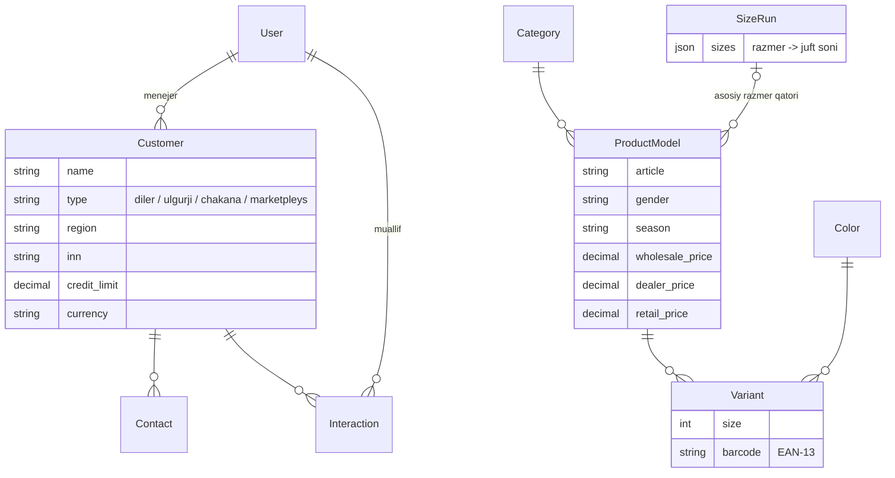

# ShoeFlow CRM

[](https://github.com/octavvos/ShoeFlow/actions/workflows/ci.yml)

Oyoq kiyim ishlab chiqaruvchi firma uchun CRM: mijozlar, katalog (model, rang, razmer), buyurtmalar, ishlab chiqarish, ombor va moliya.

**Stek:** Python 3.12 · Django 5.2 · DRF · PostgreSQL 16 · Redis · Celery · JWT · Docker

## Ishga tushirish

```bash
cp .env.example .env          # kerak bo'lsa qiymatlarni o'zgartiring
make up                       # db, redis, web, celery, celery-beat
make seed                     # demo ma'lumotlar (ixtiyoriy)
make superuser                # birinchi admin
```

`make seed` rollar bo'yicha foydalanuvchilar (`direktor`, `menejer1`, `omborchi`, ...), katalog va mijozlarni yaratadi. Hammasining paroli: `Demo-12345`.

- API: http://localhost:8000/api/v1/
- Swagger: http://localhost:8000/api/docs/
- Admin panel: http://localhost:8000/admin/

### Docker'siz (lokal)

```bash
uv sync
# .env'da DATABASE_URL hostini localhost qiling
uv run python manage.py migrate
uv run python manage.py runserver
```

## Testlar va lint

```bash
make up        # testlar compose'dagi Postgres'dan foydalanadi (localhost:5433)
make test
make lint
uv run pre-commit install   # har commitdan oldin ruff avtomatik ishlaydi
```

Har bir push'da GitHub Actions lint, migratsiyalar tekshiruvi va testlarni (coverage bilan) ishga tushiradi.

Boshqa bazada ishlatish uchun: `DATABASE_URL=postgres://... uv run pytest`.

## Ma'lumotlar modeli



## Struktura

```
config/            settings (base/dev/prod/test), urls, celery
common/            umumiy model, ruxsatlar, validatorlar, mixinlar
apps/users/        foydalanuvchi va rollar, JWT
apps/customers/    mijozlar, kontaktlar, muloqotlar tarixi
apps/catalog/      kategoriya, rang, razmer qatori, model (artikul), variant (SKU)
tests/
```

Biznes-logika `services.py`'da, murakkab so'rovlar `selectors.py`'da turadi, view'larda esa faqat HTTP qismi bo'ladi.

## Rollar

| Rol | Mijozlar | Katalog | Foydalanuvchilar |
|---|---|---|---|
| `admin` | to'liq | to'liq | to'liq |
| `director` | to'liq | to'liq | ko'rish |
| `sales_manager` | faqat o'z mijozlari | ko'rish | — |
| `accountant` | ko'rish | ko'rish | — |
| `production_head` | — | to'liq | — |
| `warehouse`, `worker` | — | ko'rish | — |

## Asosiy endpointlar

| Metod | URL | Tavsif |
|---|---|---|
| POST | `/api/v1/auth/token/` | Login (access + refresh) |
| POST | `/api/v1/auth/token/refresh/` | Tokenni yangilash |
| GET | `/api/v1/users/me/` | Joriy foydalanuvchi |
| GET/POST | `/api/v1/customers/` | Mijozlar (`?search=`, `?region=`, `?tag=`, `?type=`) |
| DELETE | `/api/v1/customers/{id}/` | Nofaol qilish (bazadan o'chirilmaydi) |
| POST | `/api/v1/customers/{id}/restore/` | Qayta faollashtirish |
| GET/POST | `/api/v1/contacts/`, `/api/v1/interactions/` | Kontaktlar, muloqotlar (`?customer=`) |
| GET/POST | `/api/v1/size-runs/` | Razmer qatorlari: `{"40": 1, "41": 2, ...}` |
| GET/POST | `/api/v1/product-models/` | Modellar (artikullar) |
| POST | `/api/v1/product-models/{id}/generate-variants/` | Rang × razmer variantlarini yaratish |
| GET | `/api/v1/variants/?barcode=...` | Shtrix-kod bo'yicha qidirish |

## Muhim qarorlar

- **Soft delete:** mijoz, model va variantlar o'chirilmaydi, faqat `is_active=False` qilinadi, shunda buyurtma va to'lov tarixi saqlanib qoladi.
- **Audit:** `Customer` va `ProductModel` o'zgarishlari `django-simple-history` orqali yoziladi (kim, qachon, nima o'zgardi).
- **Shtrix-kod:** variantga shtrix-kod berilmasa, id asosida `200…` prefiksli ichki EAN-13 yaratiladi.
- **Pul:** `DecimalField` bilan saqlanadi, valyutasi alohida maydonda (UZS/USD).

## Keyingi bosqichlar

1. `orders`: buyurtma, razmer qatori bo'yicha qatorlar, statuslar, rezervatsiya
2. `inventory`: omborlar, `StockMovement` (ledger), qoldiqlar
3. `production`: BOM, partiyalar, bosqichlar, donabay ish haqi
4. `finance`: to'lovlar, mijoz balansi, akt-sverka
5. Telegram bot (aiogram), hisobotlar, PDF/Excel
