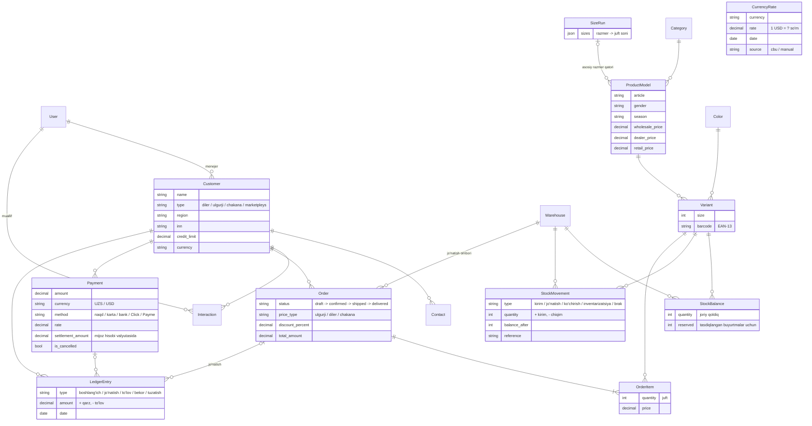
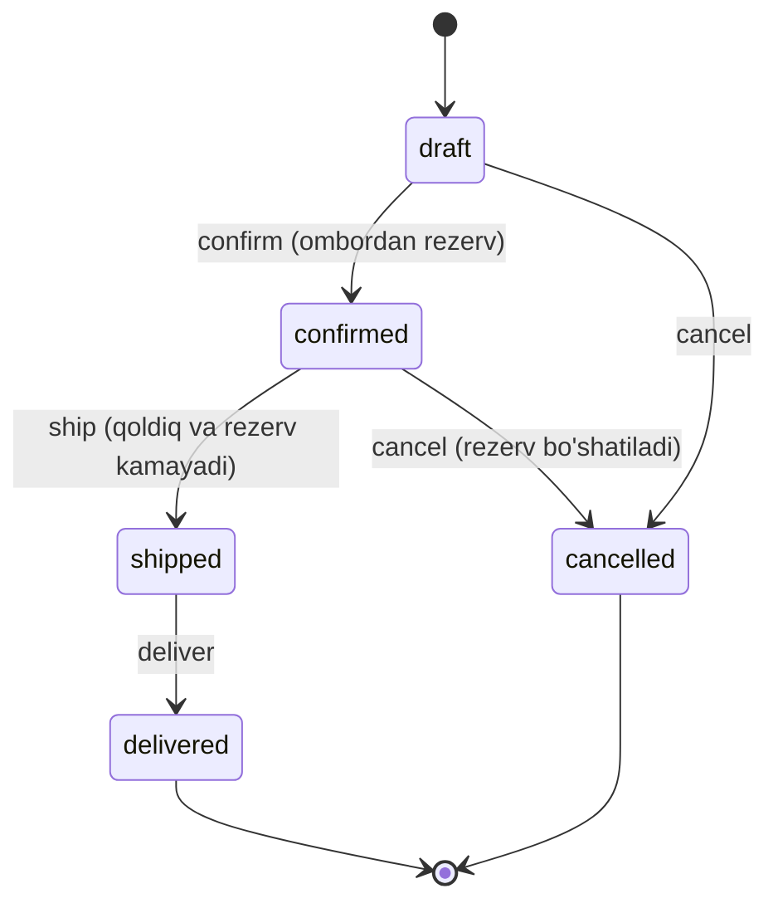

# ShoeFlow CRM

[](https://github.com/octavvos/ShoeFlow/actions/workflows/ci.yml)

Oyoq kiyim ishlab chiqaruvchi firma uchun CRM: mijozlar, katalog (model, rang, razmer), ombor, buyurtmalar va moliya (to'lovlar, qarzdorlik, akt-sverka).

**Stek:** Python 3.12 · Django 5.2 · DRF · PostgreSQL 16 · Redis · Celery · JWT · Docker

## Ishga tushirish

```bash
cp .env.example .env          # kerak bo'lsa qiymatlarni o'zgartiring
make up                       # db, redis, web, celery, celery-beat
make seed                     # demo ma'lumotlar (ixtiyoriy)
make superuser                # birinchi admin
```

`make seed` rollar bo'yicha foydalanuvchilar (`direktor`, `menejer1`, `omborchi`, ...), katalog, mijozlar, ikkita ombor va qoldiqlar, har xil holatdagi buyurtmalar, valyuta kurslari, to'lovlar va boshlang'ich qarzlarni yaratadi. Hammasining paroli: `Demo-12345`.

- API: http://localhost:8000/api/v1/
- Swagger: http://localhost:8000/api/docs/
- Admin panel: http://localhost:8000/admin/

### Docker'siz (lokal)

```bash
uv sync
# .env'da DATABASE_URL hostini localhost qiling
uv run python manage.py migrate
uv run python manage.py runserver
```

## Testlar va lint

```bash
make up        # testlar compose'dagi Postgres'dan foydalanadi (localhost:5433)
make test
make lint
uv run pre-commit install   # har commitdan oldin ruff avtomatik ishlaydi
```

Har bir push'da GitHub Actions lint, migratsiyalar tekshiruvi va testlarni (coverage bilan) ishga tushiradi.

Boshqa bazada ishlatish uchun: `DATABASE_URL=postgres://... uv run pytest`.

## Serverga deploy

Kichik VPS (1 CPU, 1 GB RAM) uchun mo'ljallangan yengil stack:
- **Host'dagi nginx:** reverse proxy, static va media fayllar, certbot orqali HTTPS
- **Docker'da** ([docker-compose.prod.yml](docker-compose.prod.yml)): 2 worker'li gunicorn, Postgres, Redis va bitta Celery jarayoni (worker va beat birga)
- Gunicorn faqat `127.0.0.1`'da ochiladi, tashqaridan unga faqat nginx orqali kiriladi

Ubuntu serverda (root sifatida) bitta buyruq:

```bash
curl -fsSL https://raw.githubusercontent.com/octavvos/ShoeFlow/main/deploy/server-setup.sh | bash -s -- api.example.uz
```

Skript quyidagilarni qiladi:
1. Docker, nginx va certbot'ni o'rnatadi.
2. Kodni `/opt/shoeflow`'ga clone qiladi va tasodifiy parollar bilan `.env` yaratadi.
3. Mavjud nginx'ga yangi sayt qo'shadi. Serverdagi boshqa saytlarga tegmaydi.
4. Stack'ni ishga tushiradi.
5. Domen DNS'da shu serverga qaragan bo'lsa, HTTPS sertifikatini oladi.

- **Yangilash:** `/opt/shoeflow/deploy/deploy.sh`. Bu `git pull`, qayta build va health check qiladi.
- **Avtomatik deploy:** GitHub'da `DEPLOY_HOST`, `DEPLOY_USER`, `DEPLOY_SSH_KEY` va `DEPLOY_KNOWN_HOSTS` secrets'larini kiritsangiz, `main`'ga har push'da testlar o'tgach CI serverni o'zi yangilaydi.
- **Demo rejim:** `server-setup.sh` har kuni 03:00 da demo ma'lumotlarni qayta tiklaydigan cron qo'shadi ([deploy/reset-demo.sh](deploy/reset-demo.sh)). Haqiqiy firma ma'lumotlari turgan serverda bu cron'ni o'chiring: `rm /etc/cron.d/shoeflow-demo-reset`.

## Ma'lumotlar modeli



### Buyurtma holatlari



## Struktura

```
config/            settings (base/dev/prod/test), urls, celery
common/            umumiy model, ruxsatlar, validatorlar, mixinlar
apps/users/        foydalanuvchi va rollar, JWT
apps/customers/    mijozlar, kontaktlar, muloqotlar tarixi
apps/catalog/      kategoriya, rang, razmer qatori, model (artikul), variant (SKU)
apps/inventory/    omborlar, qoldiqlar, harakatlar jurnali (ledger)
apps/orders/       buyurtmalar, korobka bo'yicha kiritish, holatlar
apps/finance/      to'lovlar, mijoz hisobi (ledger), kredit limiti, akt-sverka, valyuta kurslari
tests/
```

Biznes-logika `services.py`'da, murakkab so'rovlar `selectors.py`'da turadi, view'larda esa faqat HTTP qismi bo'ladi.

## Rollar

| Rol | Mijozlar | Katalog | Ombor | Buyurtmalar | Moliya | Foydalanuvchilar |
|---|---|---|---|---|---|---|
| `admin` | to'liq | to'liq | to'liq | to'liq | to'liq | to'liq |
| `director` | to'liq | to'liq | to'liq | to'liq, limitdan oshirib tasdiqlash | to'liq | ko'rish |
| `sales_manager` | faqat o'z mijozlari | ko'rish | ko'rish | o'z mijozlariniki: yaratish, tasdiqlash (limit doirasida), bekor qilish | o'z mijozlarini ko'rish | — |
| `accountant` | ko'rish | ko'rish | ko'rish | ko'rish | to'liq | — |
| `warehouse` | — | ko'rish | to'liq | ko'rish, jo'natish, yetkazish | — | — |
| `production_head` | — | to'liq | ko'rish | — | — | — |
| `worker` | — | ko'rish | — | — | — | — |

## Asosiy endpointlar

| Metod | URL | Tavsif |
|---|---|---|
| POST | `/api/v1/auth/token/` | Login (access + refresh) |
| POST | `/api/v1/auth/token/refresh/` | Tokenni yangilash |
| GET | `/api/v1/users/me/` | Joriy foydalanuvchi |
| GET/POST | `/api/v1/customers/` | Mijozlar (`?search=`, `?region=`, `?tag=`, `?type=`) |
| DELETE | `/api/v1/customers/{id}/` | Nofaol qilish (bazadan o'chirilmaydi) |
| POST | `/api/v1/customers/{id}/restore/` | Qayta faollashtirish |
| GET/POST | `/api/v1/contacts/`, `/api/v1/interactions/` | Kontaktlar, muloqotlar (`?customer=`) |
| GET/POST | `/api/v1/size-runs/` | Razmer qatorlari: `{"40": 1, "41": 2, ...}` |
| GET/POST | `/api/v1/product-models/` | Modellar (artikullar) |
| POST | `/api/v1/product-models/{id}/generate-variants/` | Rang × razmer variantlarini yaratish |
| GET | `/api/v1/variants/?barcode=...` | Shtrix-kod bo'yicha qidirish |
| GET | `/api/v1/stock/` | Qoldiqlar (`?warehouse=`, `?available_lte=5` — kam qolganlar) |
| GET | `/api/v1/stock-movements/` | Harakatlar jurnali (faqat o'qiladi) |
| POST | `/api/v1/stock-movements/receive/` | Kirim |
| POST | `/api/v1/stock-movements/write-off/` | Hisobdan chiqarish (brak) |
| POST | `/api/v1/stock-movements/transfer/` | Omborlar orasida ko'chirish |
| POST | `/api/v1/stock-movements/adjust/` | Inventarizatsiya |
| GET/POST | `/api/v1/orders/` | Buyurtmalar (`?status=confirmed&status=shipped`, `?date_from=`) |
| POST | `/api/v1/orders/{id}/items/` | Qator qo'shish (variant + juft soni) |
| POST | `/api/v1/orders/{id}/boxes/` | Korobka bo'yicha qo'shish: model + rang + korobka soni |
| PATCH/DELETE | `/api/v1/orders/{id}/items/{item_id}/` | Qatorni o'zgartirish yoki o'chirish |
| POST | `/api/v1/orders/{id}/confirm/` · `ship/` · `deliver/` · `cancel/` | Holatni o'zgartirish |
| GET/POST | `/api/v1/finance/payments/` | To'lovlar (boshqa valyutada bo'lsa kurs bo'yicha hisoblanadi) |
| POST | `/api/v1/finance/payments/{id}/cancel/` | To'lovni bekor qilish (qarama-qarshi yozuv bilan) |
| GET | `/api/v1/finance/balances/` | Mijozlar balansi (`?debtors=true`, `?over_limit=true`, `?ordering=-balance`) |
| GET | `/api/v1/finance/balances/{id}/reconciliation/?date_from=&date_to=` | Akt-sverka (`&export=xlsx` — Excel fayl) |
| GET | `/api/v1/finance/ledger/` | Mijoz hisobi yozuvlari |
| POST | `/api/v1/finance/ledger/adjustment/` | Tuzatish yoki boshlang'ich qoldiq |
| GET/POST | `/api/v1/finance/rates/` | Valyuta kurslari; `POST .../fetch/` — Markaziy bankdan hozir olish |

## Muhim qarorlar

- **Soft delete:** mijoz, model va variantlar o'chirilmaydi, faqat `is_active=False` qilinadi, shunda buyurtma va to'lov tarixi saqlanib qoladi.
- **Audit:** `Customer` va `ProductModel` o'zgarishlari `django-simple-history` orqali yoziladi (kim, qachon, nima o'zgardi).
- **Shtrix-kod:** variantga shtrix-kod berilmasa, id asosida `200…` prefiksli ichki EAN-13 yaratiladi.
- **Pul:** `DecimalField` bilan saqlanadi, valyutasi alohida maydonda (UZS/USD).
- **Ombor — ledger:** qoldiq hech qachon to'g'ridan-to'g'ri o'zgartirilmaydi. Har bir o'zgarish o'zgarmas `StockMovement` yozuvi bo'ladi, `StockBalance` esa joriy qoldiqni shu tranzaksiya ichida saqlaydi. Tarixni istalgan vaqt tekshirsa bo'ladi.
- **Konkurensiya:** rezerv va jo'natishda qoldiq qatorlari `select_for_update` bilan bloklanadi va har doim bir xil tartibda (ombor id → variant id) olinadi, shuning uchun deadlock bo'lmaydi. [test_order_concurrency.py](tests/test_order_concurrency.py) ikki menejer bir vaqtda oxirgi juftlarni olishga urinishini tekshiradi: faqat bittasi muvaffaqiyatli bo'ladi.
- **Rezerv "hammasi yoki hech narsa":** buyurtmadagi bitta razmer yetmasa ham hech narsa rezerv qilinmaydi, javobda esa nima qancha yetmasligi qaytariladi.
- **Korobka:** `POST /orders/{id}/boxes/` razmer qatorini juftlarga yoyadi. Masalan, `{"40": 1, "41": 2}` qatoridan 3 korobka 40-razmerdan 3 juft, 41-razmerdan 6 juft beradi.
- **Biznes xatolari:** services qatlami DRF'ga bog'liq emas va `BusinessError` ko'taradi. Uni umumiy exception handler 400 javobga aylantiradi.
- **Chegirma:** savdo menejeri ko'pi bilan 10% chegirma bera oladi, undan kattasini faqat rahbariyat beradi.
- **Mijoz hisobi ham ledger:** qarz `LedgerEntry` yozuvlari yig'indisidan hisoblanadi. Jo'natish qarzni oshiradi, to'lov kamaytiradi. To'lov o'chirilmaydi: bekor qilinsa, qarama-qarshi yozuv qo'shiladi. Akt-sverka to'g'ridan-to'g'ri shu jurnaldan olinadi.
- **Kredit limiti:** buyurtma tasdiqlanayotganda `joriy qarz + tasdiqlangan, lekin jo'natilmagan buyurtmalar + shu buyurtma ≤ limit` sharti tekshiriladi. Limit 0 bo'lsa, faqat oldindan to'lov bilan ishlanadi. Rahbariyat limitdan oshirib tasdiqlay oladi. Tekshiruvda mijoz qatori bloklanadi, shuning uchun parallel tasdiqlashlar limitni ikki marta "sarflay" olmaydi.
- **Valyuta:** har bir mijozning hisob valyutasi bor. Boshqa valyutadagi to'lov to'lov sanasidagi kurs bo'yicha o'tkaziladi va kurs to'lov bilan birga saqlanadi. Hisob-kitobi bor mijozning valyutasini o'zgartirib bo'lmaydi.
- **Celery:** `fetch_cbu_rates` vazifasi har kuni soat 09:00 da Markaziy bank kursini oladi (`celery-beat`). Qo'lda kiritilgan kursga tegmaydi.
- **Balanslar ro'yxati:** har bir yig'indi alohida subquery'da hisoblanadi. Bir nechta `JOIN` ustida `Sum` qilinganda qatorlar ko'payib, summa noto'g'ri chiqib qolardi.

## Keyingi bosqichlar

1. `production`: BOM, xomashyo ombori, partiyalar, bosqichlar, donabay ish haqi
2. Celery vazifalari: qarz eslatmalari, Excel import
3. Telegram bot (aiogram), hisobotlar (savdo, qarzdorlik, tannarx)
